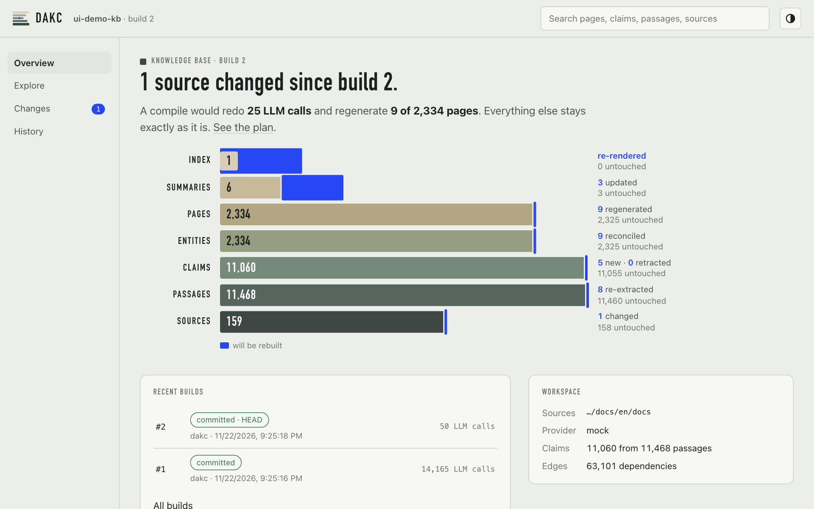
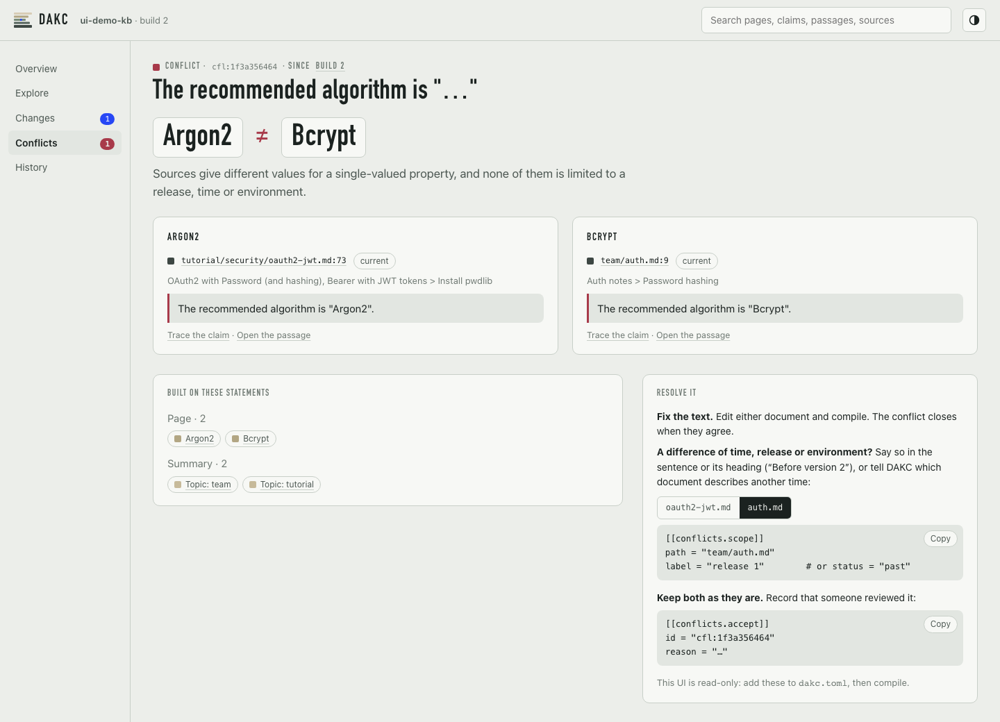

# DAKC: Dependency-Aware Knowledge Compiler

**Knowledge bases shouldn't need to be rebuilt every time a document changes.**
DAKC brings incremental compilation, dependency tracking and full-rebuild
verification to AI-generated knowledge. It tracks claim-level dependencies,
selectively rebuilds invalidated artifacts, and checks incremental results
against an independent full rebuild.

Given a directory of documents, it builds and maintains an LLM-generated
knowledge base: claims, entity pages, topic summaries and an index. When the
sources change, it **recomputes only what has become invalid** and can prove
that the result equals a full rebuild. The same problem appears wherever
LLM-derived knowledge must track evolving inputs: documentation generated
from codebases, research knowledge bases built from papers, policy and
compliance repositories, and long-lived agent memory.

It does this with a build-system model applied to knowledge:

- Every derived artifact records the exact inputs it was built from.
- Sources are hashed per paragraph.
- Claims are content-addressed.
- Rebuilds stop as soon as a recomputed artifact comes out unchanged
  (*early cutoff*).

```text
source ─▶ passage ─▶ claim ─▶ entity / relationship ─▶ page ─▶ topic summary ─▶ index
 (file)   (paragraph)  (fact)      (who / what)        (wiki)     (overview)
```

Edit one sentence in a 5,000-document corpus (deterministic benchmark) and
DAKC re-extracts one paragraph and regenerates only the pages whose claims
changed. Pages whose
claims are unchanged but whose citations moved are re-rendered without an LLM
call. Everything else keeps its exact bytes. `dakc compile --dry-run` tells
you all of this before anything is spent.

**On real docs:** across the last 50 commits to FastAPI's documentation, DAKC
used about 148,000 input tokens (317 LLM calls) where re-processing each
changed file used about 35 million (284,354 calls), and its result equalled a
full rebuild at every commit. Most of that gap comes from a large
release-notes file edited in almost every commit; see
[examples/fastapi-docs](examples/fastapi-docs/README.md) for the breakdown,
the per-commit costs and the limitations.

> **Status:** research prototype / MVP, CLI-first, local-first. Python 3.12+,
> SQLite, no GPU, no network required (deterministic providers are the
> default). See [what is not done](#limitations).

**Who uses it, and how:** [docs/using-dakc-by-role.md](docs/using-dakc-by-role.md)
covers docs maintainers, developers, CI owners, solution architects,
reviewers and AI agents.

## Why this exists

The research phase audited twelve open-source LLM-wiki and graph-RAG projects
at the code level ([competitive analysis](research/COMPETITIVE_ANALYSIS.md),
[gap report](research/TECHNICAL_GAP.md)). In those twelve, we did not find
one that does all of the following. That is a statement about what we
audited, not proof that no such system exists.

- tracks dependencies below the file level, or between derived artifacts
  (page → summary → index);
- stops propagation when a recomputed artifact is unchanged;
- tests incremental output against a full rebuild;
- keeps claim identity stable when an LLM rewords unchanged text.

The usual pattern is "a file changed, re-ingest it, and let the LLM merge the
result into existing pages". That pattern is costly, and it keeps facts the
source no longer states (for example llm_wiki issue #837; see the analysis for
code citations). The techniques DAKC uses are not new: verifying traces and
early cutoff come from build systems (Shake, Bazel, Salsa), support counting
from incremental view maintenance, and content addressing from Git. The
contribution is applying them correctly at claim granularity, with a test
oracle.

## Quick start

```bash
pip install dakc                 # Python 3.12+; add [mcp] for the MCP server, [api] for the REST API
dakc ingest ./my-documents       # discover, hash, extract, compile -> ./wiki
```

To run the examples, tests and benchmarks, work from a clone:

```bash
git clone https://github.com/thejasrao262003/dependency-aware-knowledge-compilation.git
cd dependency-aware-knowledge-compilation
uv sync --locked --extra dev && source .venv/bin/activate   # or: pip install -e '.[dev]'

mkdir demo && cp -r examples/sample-knowledge-base demo/knowledge && cd demo
dakc ingest ./knowledge
```

`ingest` creates `dakc.toml`, the store in `.dakc/dakc.db`, and Markdown
output in `wiki/` (`pages/`, `summaries/`, `index.md`). Your source files are
never modified.

## Walkthrough: the Definition of Done

```bash
dakc graph                                   # artifact and edge counts by layer
dakc graph --source databases/postgresql.md  # everything downstream of one source

# edit one claim in a source document...
perl -pi -e 's/supports JSONB/stores JSONB in a binary format/' knowledge/databases/postgresql.md

dakc check                       # new / modified / deleted / renamed / unchanged (content hashes)
dakc explain page:jsonb          # STALE, with the reason and the upstream sources
dakc compile --dry-run           # exactly which artifacts will be affected; writes nothing
dakc compile                     # incremental; only the plan above is executed
dakc diff 1                      # what changed between build 1 and HEAD
dakc verify --against-full       # invariants + identical to a from-scratch rebuild?
dakc rollback                    # restore the previous build (store + wiki files)
```

The dry run in this walkthrough prints the following (real output, unedited):

```text
Compilation Plan
----------------
Strategy: dakc

New Sources:        0
Modified Sources:   1
Deleted Sources:    0
Renamed Sources:    0
Unchanged Sources:  6

Passages to (re-)extract:   1   (extraction cache hits: 0)
Affected Claims:            5   (new 1, retracted 1, changed 0, provenance-only 3, reproduced unchanged 0)
Affected Entities:          2
Affected Knowledge Pages:   2   (regenerate 2, re-render citations only 0, delete 0, checked & unchanged 3)
Unaffected Knowledge Pages: 20
Summaries:                  regenerate 0, re-render 0, delete 0, checked & unchanged 1
Index:                      unchanged

Planned Operations:
- Re-extract 1 passage(s)
- Reconcile 2 entities
- Regenerate 2 page(s), re-render 0
- Regenerate 0 summaries, re-render 0

Estimated LLM Calls: 0 (exact)

No files modified.
```

This is the PRD's example. The edited paragraph also states "PostgreSQL
supports Transactions" and "PostgreSQL supports Indexing". Re-extraction
reproduces those claims with the same ids, so the Transactions, Indexing and
Ledger pages are *checked and unchanged*. Only the JSONB and PostgreSQL pages
are regenerated.

With the default heuristic provider, LLM calls are 0 and the plan is exact.
With an LLM provider, the plan counts the extraction calls it *would* make,
exactly, and does not make them. It estimates the facts in new text with the
free heuristic extractor, so its page and summary counts are labelled an
**estimate**.

## Commands

| Command | What it does |
|---|---|
| `dakc init [--source DIR] [--provider P]` | Create `dakc.toml` |
| `dakc ingest DIR` | Register a corpus and compile it |
| `dakc check [DIR]` | Classify sources by content hash, including renames and duplicates |
| `dakc compile [--incremental \| --full] [--dry-run] [--json]` | Compile; `--full` is the correctness baseline |
| `dakc compile --strategy file` | The file-level baseline used in the benchmark |
| `dakc graph [--source X] [--format text\|json\|dot\|reactflow]` | Inspect or export the dependency graph |
| `dakc explain ID` | Dependencies, dependents, upstream sources, signatures, history, VALID/STALE |
| `dakc trace PAGE` | Each displayed sentence → cited claims → passage → source version → exact evidence sentence |
| `dakc duplicates` | Advisory list of claims that are likely the same fact in other words (nothing is merged) |
| `dakc conflicts [ID] [--all] [--check]` | Statements in different documents that cannot both be true, with the file and line of each ([below](#conflicts-between-sources)) |
| `dakc status` | HEAD, counts, and what is stale against the current sources |
| `dakc builds` / `dakc diff A [B]` | Audit log; artifact-level diff between builds |
| `dakc rollback [--to N]` | Restore an earlier committed build (later builds' artifact versions are discarded; their records stay in `builds`) |
| `dakc verify [--against-full]` | Invariant and provenance checks, citation coverage, equality with a full rebuild |
| `dakc serve` | Local web UI and read-only REST API (`/status /check /plan /graph /artifacts /artifacts/{id}[/content\|/trace\|/downstream] /builds /diff /duplicates /conflicts`) |
| `dakc mcp [--read-only]` | MCP server for AI agents ([below](#mcp-server-for-ai-agents)) |
| `dakc watch` | Recompile incrementally on file changes |
| `dakc review --base REF` | Knowledge diff against a git ref: facts added and retracted, pages affected, LLM calls and cost; never calls a model |
| `dakc sources` | Configured sources: type, path prefix, location, documents at HEAD ([below](#sources-and-publishers)) |
| `dakc publish [NAME] [--dry-run] [--reset]` | Bring publishers up to date with HEAD; retries what a failed publish left pending |

IDs can be given in friendly form: `page:database-architecture`,
`entity_postgresql`, `source:databases/redis.md`, a source path, or a page
title. Commands that write (`ingest`, `compile`, `rollback`) take the
workspace build lock; pass `--wait SECONDS` to queue behind a running build
instead of failing. Most commands accept `--json`.

## Python API

Everything the CLI does is available as a library; the CLI, the REST API and
the MCP server are thin layers over it.

```python
import dakc

with dakc.open("demo") as kb:                 # a directory holding dakc.toml
    plan = kb.plan()                          # what a compile would do; nothing written or spent
    if plan.has_work():
        report = kb.compile()                 # incremental; atomic; wiki files updated
        print(report.status, report.llm_calls())

    page = kb.read("PostgreSQL")              # rendered Markdown, version, metadata
    for s in kb.trace("page:postgresql").sentences:
        print(s.sentence, "->", s.cites)      # each sentence and the claims it cites

    kb.explain("page:jsonb").status           # VALID / STALE, with reasons
    kb.downstream("databases/postgresql.md")  # what an edit to this file would invalidate
```

Module functions: `dakc.open(path)`, `dakc.init(path, source_dir=...)`,
`dakc.ingest(directory, workspace)`. `KnowledgeBase` methods: `status`,
`check`, `plan`, `compile`, `artifacts`, `read`, `explain`, `trace`,
`downstream`, `graph_stats`, `export_graph`, `builds`, `diff`, `duplicates`,
`verify`, `rollback`, `sources`, `publish`. Every result is a dataclass with `to_dict()`.

Errors derive from `dakc.DakcError`: `WorkspaceNotFound`, `ArtifactNotFound`,
`InvalidArgument`, `BuildLocked`, `CompileFailed` (with `.preserved`: HEAD
still points at the previous build), `CostNotAllowed`, `RollbackError`,
`SourceError` and `PublishError`.
`compile` and `rollback` hold the workspace build lock. Read methods never take
it and see a consistent snapshot while a build runs. A `KnowledgeBase` holds
one SQLite connection, so use one per thread. Details are in
[docs/python-api.md](docs/python-api.md).

## MCP server for AI agents

`dakc mcp` exposes a workspace to agents over the Model Context Protocol.
It needs the `mcp` extra: `pip install 'dakc[mcp]'`.

```bash
claude mcp add dakc -- dakc mcp --workspace /absolute/path/to/demo   # Claude Code
claude mcp add dakc -- uvx --from 'dakc[mcp]' dakc mcp --workspace /absolute/path/to/demo   # nothing preinstalled
```

Other clients take the usual JSON configuration:

```json
{ "mcpServers": { "dakc": { "command": "dakc", "args": ["mcp", "--workspace", "/absolute/path/to/demo"] } } }
```

| Tools | Kind |
|---|---|
| `status`, `check_sources`, `list_artifacts`, `read_artifact`, `explain`, `trace`, `downstream`, `graph_stats`, `builds`, `diff_builds`, `duplicates`, `verify` | read-only |
| `compile` | previews by default; builds only with `apply=true` |
| `rollback` | needs an explicit build id; marked destructive |

Safety rules:

- **One workspace.** The server is bound to the workspace it was started with.
- **Preview first.** `compile` previews unless called with `apply=true`.
- **Cost guard.** With an LLM provider, a build planned to exceed
  `--max-llm-calls` (default 100) is refused.
- **Read-only mode.** `--read-only` removes `compile` and `rollback`.
- **Bounded outputs.** Every list is capped by a `limit` argument, and totals
  are always reported.

The server needs a workspace built first (`dakc ingest DIR`). The default
transport is stdio. `--transport streamable-http` serves HTTP on
`127.0.0.1:8766`. There is no authentication yet, so both HTTP servers
refuse to listen beyond this machine. [docs/mcp.md](docs/mcp.md) covers
setup, the tools, the safety rules and the known limitations.

## Web UI

`dakc serve` opens a local, read-only UI for a workspace. It needs the `api`
extra: `pip install 'dakc[api]'`.



- **Overview.** The knowledge base shown as layers, from the source documents
  at the bottom to the index at the top, with what the next compile would
  change (or what the last one changed).
- **Changes.** The exact plan for pending edits, before anything runs: which
  documents changed, how many LLM calls the compile needs, and which pages and
  summaries it would regenerate.
- **Explore and read.** Search pages, claims, passages and sources. On a page,
  select a citation to see its claim, the source document and version, and the
  exact sentence it came from.
- **Dependencies, impact and graph.** What an artifact is built from,
  everything an edit to it would invalidate, and the dependency graph around
  it.
- **History.** Every build, and what it changed.
- **Conflicts.** Statements in different documents that cannot both be true,
  with each document's exact sentence, file and line, the pages built on
  them, and how to resolve it. A claim, page or document involved in one
  says so ([below](#conflicts-between-sources)).


The UI is plain HTML, CSS and JavaScript that ships inside the package. There
is no build step and no CDN, and it works offline. Like the REST API, it only
listens on this machine. To see it on FastAPI's docs, run
`python examples/fastapi-docs/ui_demo.py`, then
`dakc serve -w examples/fastapi-docs/.work/ui-demo-kb`.

## Integrations

**MkDocs.** Add one line to an existing `mkdocs.yml`:

```yaml
plugins:
  - search
  - dakc            # pip install 'dakc[mkdocs]'
```

- Every `mkdocs build`, and every live reload of `mkdocs serve`, compiles
  the docs incrementally.
- The knowledge base is published under `/knowledge/`, and every cited fact
  links back to the docs page it came from.
- In CI, cache the workspace directory and every build is incremental.

See [docs/integrations/mkdocs.md](docs/integrations/mkdocs.md) and the
runnable [examples/mkdocs-site](examples/mkdocs-site/mkdocs.yml).

**GitHub pull requests.** The action comments on every pull request with what
the change does to the knowledge base: facts added and retracted, pages
affected, and the LLM calls and cost of applying it. It never calls a model.

```yaml
- uses: thejasrao262003/dependency-aware-knowledge-compilation@v0.7.0
  with:
    workspace: .
```

See [docs/integrations/github-action.md](docs/integrations/github-action.md).

**Real documentation history.**
[examples/fastapi-docs](examples/fastapi-docs/README.md) replays the last 50
commits that changed FastAPI's documentation. At every commit it measures
what keeping a knowledge base current costs under each strategy, and checks
that DAKC's result equals a full rebuild.

## Sources and publishers

DAKC does not care where content comes from, or where compiled knowledge
goes. A **source connector** lists versioned items and reads them. A
**publisher** receives what changed. The compiler between them is the same
either way. The design is in
[docs/rfcs/0001-sources-and-publishers.md](docs/rfcs/0001-sources-and-publishers.md).

```toml
[[sources]]                 # without [[sources]], [dakc] source_dir is the only source
name = "docs"
type = "filesystem"
path = "knowledge"
prefix = ""                 # these files keep their paths

[[sources]]
name = "policies"
type = "filesystem"         # or an installed connector, or "custom" with factory = "module:attr"
path = "/srv/policies"      # its documents appear under policies/

[[publishers]]
name = "feed"
type = "jsonl"              # a change feed: one line per upsert or delete
path = "feed/changes.jsonl"
kinds = ["claim", "page", "summary"]
```

**One knowledge base, several systems.**
- A fact stated in two sources is supported by both, and survives the
  deletion of either.
- Connectors with stable native ids (a Drive file id, a CRM record id) keep a
  document's identity when it is moved *and* edited.
- An unchanged revision is never read.
- A source that cannot be listed fails the build before anything is
  committed, rather than looking like a mass deletion.
- `verify --against-full` checks a mixed-source workspace exactly like a
  single directory.

**Publishers converge.** DAKC records which version of every artifact each
publisher has acknowledged, and sends only the difference:
- A target that is down leaves its changes pending. The build still
  commits, and the next `compile` or `dakc publish` resumes.
- Rollbacks and new publishers need nothing special.
- Every record carries its text, kind, build and the source documents it
  derives from. A vector-database integration can therefore re-embed only
  changed facts, delete retracted ones, and keep citations.

**Plugins.** Connectors and publishers register Python entry points
(`dakc.sources`, `dakc.publishers`). Alternatively, a local module can be
loaded with `type = "custom"`, `factory = "module:attr"` and
`plugin_path = "plugins"`.

Only the filesystem connector and the `jsonl` publisher ship today. Remote
connectors (Drive, SharePoint, GitHub), change feeds and permissions are
phases 2 and 3 of the RFC.

## Conflicts between sources

When two documents disagree, both claims stay on the page, each with its own
sources. DAKC also tells you, at every compile:

```text
$ dakc compile
...
Conflicts:                  1 open   (new 1, resolved 0)   `dakc conflicts` lists them

$ dakc conflicts
conflict  cfl:1f3a356464  The recommended algorithm is "…"
    'Argon2'                      tutorial/security/oauth2-jwt.md
    'Bcrypt'                      team-notes.md
```

`dakc explain cfl:1f3a` shows each sentence with its file and line, the
heading it sits under, and the pages and summaries built from it. This is
real drift: FastAPI moved from Bcrypt to Argon2 in 0.118.0, and notes copied
from the earlier docs still say Bcrypt. [A walkthrough](examples/fastapi-docs/results/conflicts-walkthrough.md)
follows it from the pull request that introduces it to its resolution, and
`dakc serve` shows it in its Conflicts view:

 Fix either
document, compile, and the conflict closes. Detection is advisory: it never
changes a claim or a page. The rules call no model; the optional verifier
(below) does.

**Most differences are not conflicts.** An MVP that ran on MongoDB and a
production system on PostgreSQL is history, not a contradiction. DAKC
reports a **conflict** only when the same property has two values in the
same scope:
- **Scope** is read from the sentence ("in release 1", "was"), the heading
  ("Release 1 (MVP)", "Production", "Rejected alternatives") and the path
  (`archive/`, `techstack001.md`, `docs/adr/0004-…`).
- **Differences that scope explains** are listed as *scoped* with `--all`.
- **An edit in place** (MongoDB → PostgreSQL in the same file) is not a
  conflict at all: the old claim is retracted.
- **Different values of a multi-valued property** ("supports JSONB",
  "supports Indexing") are not compared.

When the text gives no hint, tell DAKC in `dakc.toml`:

```toml
[[conflicts.scope]]
path = "docs/mvp/**"
label = "release 1"        # or status = "past" | "proposed"

[[conflicts.accept]]       # reviewed, and kept as is
id = "cfl:0123456789"
reason = "two clusters, two ports"
```

Notes written one per session or meeting are each their own scope with a
per-document label. A note that records a decision and a later note that
reverses it are then *scoped*, not a conflict. Two statements in one note are
still compared, and a note against a current document is judged as before:

```toml
[[conflicts.scope]]
path = "sessions/**"
status = "past"
label = "{path}"           # "{dir}": one scope per folder
```

**The rules are precise but narrow.** They raised no false alarm on
FastAPI's documentation (0 findings over 11,067 claims) or on 55 labelled
pairs that are scoped or compatible. But they compare only statements of the
same shape: on a held-out set of contradictions written the way people
write, they catch 4 of 55. "Ledger is written in Go" against "Ledger is a
Python service" shares no wording at all.

**The verifier asks a model about those.** It is off by default:

```toml
[conflicts]
verifier = "llm"     # uses the workspace's provider
max_checks = 500     # pairs judged per compile; the rest wait for the next one
```

For each new claim, it picks the few most similar claims about the same
entity in other documents and has the model judge each pair. Its findings
are marked **possible**, and scope still applies to them. A verdict is
cached by the pair of claims, so each pair is paid for once.

- **Quality.** On 55 labelled contradictions, the rules plus the verifier
  catch 52 with gpt-5-mini (no false alarm in 55 other pairs), or 53 with
  gpt-4o-mini (2 false alarms). The set is small and model-written, and it
  was used to fix DAKC's scope reading, so read this as optimistic.
- **Cost on FastAPI's docs.** Turning it on judges about 23,000 pairs once:
  about 70 cents with gpt-4o-mini, or about $6 with gpt-5-mini, whose
  reasoning is most of its output. Keeping it on through 50 real commits
  judged 291 pairs: under a cent, or about 8 cents.
- **Checking first.** `dakc compile --dry-run` counts its calls.

The conflict step takes under a millisecond on a one-file edit. The PR
comment from `dakc review` lists the conflicts a change introduces or
resolves (rules only, since review uses the free provider), and agents see
them through the MCP `conflicts` tool. The taxonomy, design and evaluation
are in [docs/rfcs/0002-conflicts.md](docs/rfcs/0002-conflicts.md).

## Links between documents

Rename a heading, or move a file, and the links other documents make to it break
silently. DAKC reads the links in every document at each compile and reports the ones
that point at a document or heading that no longer exists. When it saw the rename that
broke a link, it names the new target:

```text
$ dakc compile
...
Links:                      1 broken   (new 1, fixed 0)   `dakc links` lists them

$ dakc links
broken  gateway.md:3  [Redis setup](caching.md#redis-setup)
        caching.md has no heading #redis-setup: "Redis setup" is now "Rate-limit store"
        fix: caching.md#rate-limit-store
```

- **It costs nothing to keep current.** Renaming a heading re-extracts nothing, makes no
  LLM call and regenerates no page. Every link is checked again in a few milliseconds.
- **Before merging.** The `dakc review` PR comment says a change would "break 1 link
  between documents", with the fix.
- **Before renaming.** `dakc links PATH --to` lists every document that links to `PATH`,
  and the web UI shows them on the document's Impact tab.
- **Elsewhere:** `dakc links --check` exits 1 for CI, `status` counts broken links, and
  there is an MCP `links` tool and `GET /links`.
- **What counts.** Anchors are a heading's explicit id (`{ #id }`, `<a id>`) or, without
  one, both GitHub's and MkDocs' slug of its text. Directory-style links (`../page/`) are
  read as MkDocs reads them.
- **What doesn't.** External URLs are not checked; a link checker such as lychee does
  that. A link outside the knowledge base, or a directory-style link that never resolved,
  is left alone rather than reported.
- **Measured** on FastAPI's docs by `examples/fastapi-docs/links_eval.py`:
  - **No false alarms:** 0 broken among 166 internal links, checked in 5 ms.
  - **Planted renames:** renaming the heading each of 42 cross-document links points at
    was reported 42 times, every time with the right fix. Moving the linked document:
    42 of 42.
  - **Real history:** none of the last 50 real commits broke a link.

## Guarantees, and how each is checked

| Concern | What DAKC does | Checked by |
|---|---|---|
| Incremental = full | Signatures, early cutoff, support counting | `dakc verify --against-full`; regression suite (every scenario, random edit sequences); benchmark oracle |
| Concurrent builds | A workspace build lock covers the whole build; the commit also refuses if HEAD moved since the state was loaded. Readers are never blocked (SQLite WAL) | `tests/integration/test_concurrency.py` (interleaving, two real processes) |
| Model / prompt drift | Extractor, page-writer and summarizer fingerprints (model, prompt, schema) are recorded per artifact; anything built by a different provider is rebuilt | `tests/integration/test_model_drift.py` |
| DAKC's own logic changing | Versioned layers (`dakc.versions`: parser, claim identity, entity resolution, rendering) are recorded with every build; a change re-runs exactly that layer, and rendering changes need no provider calls | `tests/integration/test_model_drift.py` |
| Provenance | Every claim records the exact evidence sentences in each supporting passage. `dakc trace` follows displayed sentence → claim → passage → source version. `provenance = "strict"` renders only sentences that cite a claim | `tests/integration/test_provenance.py`; `dakc verify` reports citation coverage |
| Contradictions | Conflicting claims are both kept, each with its own sources; deleting a source retracts exactly the claims it alone supported. Conflicts are flagged, never resolved, and the incremental findings equal a detection from scratch | `tests/integration/test_contradictions.py`, `tests/integration/test_conflicts.py`; `dakc verify`; benchmark scenario S9 |
| Claim identity | Exact after normalization (never merged by similarity); paraphrases are only *reported* | `benchmarks/equivalence.py` (precision/recall incl. hard negatives) |
| Failures and crashes | All-or-nothing commit; the extraction cache survives for retries; rollback to any earlier committed build | failure-injection and process-kill tests |

## How it decides what to rebuild

Each artifact stores a **signature**: the hash of exactly the inputs it read,
plus the fingerprint (algorithm/model/prompt) of the provider that built it.
An artifact is rebuilt if and only if its signature changes. The full model,
including deletion semantics and dry-run precision, is in
[docs/dependency-model.md](docs/dependency-model.md).

| Change | What DAKC does |
|---|---|
| One sentence edited | Only that sentence is sent to the extractor, with its paragraph as context. Claims of unchanged sentences are reused verbatim, so their pages are untouched even when an LLM would have reworded them. A sentence whose pronoun refers to the edited one is re-extracted too. |
| Sentence deleted or paragraphs reordered | Zero extraction calls; claims of the deleted sentence are retracted. |
| Source deleted | Remove its passages from claims' support sets. Retract claims left unsupported. Pages whose claims survive elsewhere are only re-rendered (citations). |
| Source renamed | Same source id, **zero** LLM calls; citations re-rendered. |
| Duplicate document added | Extraction-cache hit, **zero** extraction calls. |
| Entity aliases changed (`[aliases]` in `dakc.toml`) | Entity resolution re-runs deterministically; only pages whose membership changed are rebuilt. |
| A fact about a hub entity, or a page in a large topic, changes | The hub page (more than 64 claims) and large topic summaries (more than 64 pages) are built in content-defined sections. Only the sections whose inputs changed are rewritten, then their parent. No prompt reads a whole hub or a whole large topic. |
| Prompt or model changed | The provider fingerprint changes. Writer and summarizer changes invalidate exactly the pages and summaries they built. An extractor change re-extracts every passage, because each passage records which extractor produced its claims. Pages are regenerated only where the re-extracted claims differ. |
| Build fails (provider error, crash, injected fault) | Nothing is committed. HEAD and the wiki are unchanged; paid extraction results are cached for the retry. |

## Providers

Pick one with `provider = "..."` in `dakc.toml` (or `dakc init --provider ...`). Hosted
APIs read their key from an environment variable, and each provider has a default
model, so a name and a key are usually all it takes:

```toml
[dakc]
provider = "gemini"            # and export GEMINI_API_KEY=...
```

| `provider =` | Model calls go to | Key | Default model |
|---|---|---|---|
| `heuristic` (default) | nowhere: deterministic extraction and template writers, free, offline | none | none |
| `mock` | nowhere, but each call is *counted* as an LLM call with estimated tokens (benchmarks) | none | none |
| `claude-code` | Claude, through your [Claude Code](https://code.claude.com) login: **no API key** ([below](#claude-without-an-api-key)) | none | `haiku` |
| `anthropic` (or `claude`) | Claude API, official SDK (`pip install 'dakc[anthropic]'`) | `ANTHROPIC_API_KEY` | `claude-opus-5-5` |
| `openai` | OpenAI; with `base_url`, any OpenAI-compatible server (vLLM, a gateway) | `OPENAI_API_KEY` | `gpt-5.4-mini` |
| `gemini` (or `google`) | Google Gemini | `GEMINI_API_KEY` | `gemini-flash-latest` |
| `grok` (or `xai`) | xAI Grok | `XAI_API_KEY` | `grok-4.3` |
| `deepseek` | DeepSeek | `DEEPSEEK_API_KEY` | `deepseek-flash` |
| `mistral` | Mistral | `MISTRAL_API_KEY` | `mistral-small-latest` |
| `groq`, `openrouter`, `together` | many vendors' models | `GROQ_API_KEY`, `OPENROUTER_API_KEY`, `TOGETHER_API_KEY` | set `model` |
| `ollama`, `lmstudio` | models on your machine | none | `llama3.1` (Ollama); set `model` (LM Studio) |
| `custom` | your own client: `factory = "module:callable"` returning an object with `.fingerprint` and `.complete(system, user, json_schema=None)` | yours | yours |

Anything in `[provider.<name>]` overrides the defaults: `model`, `base_url`,
`api_key_env`, `json_mode` (`none`, `json_object` or `json_schema`), `max_tokens`,
`temperature`. Default models come from each provider's documentation (November
2026), and providers retire models: if one is gone, set `model`. DAKC's requests to
each provider are tested against a fake server; `claude-code` was also run against the
real CLI. A changed model or provider rebuilds what it produced, and nothing else (see
*Guarantees*).

### Claude without an API key

`provider = "claude-code"` sends DAKC's model calls through the Claude Code CLI, with
whatever login it has, including a Claude subscription:

```toml
[dakc]
provider = "claude-code"

[provider.claude-code]
model = "haiku"                # or sonnet, opus, a full model id
```

- **What runs.** One `claude -p` per model call, in an empty scratch directory, with
  tools, MCP servers and settings turned off, so no project's CLAUDE.md, hooks or
  servers load. DAKC never reads or stores credentials. Set `binary = "/path/to/claude"`
  if it is not on `PATH`.
- **Measured** (Claude Code 2.1.312, `haiku`): a first build of two documents made 7
  calls in 14 seconds; an edit to one sentence, 3 calls in 13 seconds. Each call takes
  about 4 seconds, and Claude Code adds about 950 tokens of its own to each request.
- **Use it for incremental work.** A compile runs its layers one after another, so even
  a small edit takes a few calls' time, and a first build of a large corpus makes
  thousands of calls. Claude subscription limits assume ordinary individual use, so DAKC
  notes when a compile plans more than 200 calls and suggests an API-key provider.

The heuristic extractor is a baseline: it treats capitalized and camel-case
terms as entities and each such sentence as a claim. Use an LLM provider for
extraction quality. The invalidation guarantees do not depend on the
extractor.

## Benchmark

Two kinds of numbers appear here, and they are never mixed:

- **Deterministic benchmark (mock provider).** Large seeded synthetic
  corpora. LLM calls are counted exactly but no model is called, and tokens
  are estimated from text length. These results reproduce exactly, and CI
  checks that they do. They measure how much work each strategy schedules on
  this synthetic workload. They do not predict the savings on your corpus.
- **Real-model measurements.** One hosted model on small corpora, with
  provider-reported tokens. They are indicative, not exactly reproducible.

<!-- BENCHMARK:START (generated by python -m benchmarks.report) -->
### Deterministic benchmark (mock provider)

Seeded synthetic corpus, **5,000 documents** (48,933 claims, 2,501 pages, 279,406 dependency edges). Deterministic mock provider: LLM calls are counted exactly, tokens are estimated. All three strategies run in the same engine. *File-level* emulates the strategy of existing LLM-wiki tools.

| Scenario | Input tokens (est.): full / file-level / DAKC | LLM calls: full / file-level / DAKC | Pages regenerated: full / file-level / DAKC | Equal to full rebuild (DAKC) |
|---|---|---|---|---|
| S0 no change | 3,663,730 / 0 / **0** | 34,767 / 0 / **0** | 2,501 / 0 / **0** | yes |
| S1 one source modified | 3,663,729 / 289,027 / **6,036** | 34,767 / 766 / **13** | 2,501 / 43 / **5** | yes |
| S2 five sources modified | 3,663,706 / 439,248 / **16,893** | 34,767 / 1,195 / **38** | 2,501 / 90 / **15** | yes |
| S3 one source deleted | 3,662,976 / 212,492 / **14,692** | 34,759 / 542 / **27** | 2,501 / 22 / **11** | yes |
| S4 one source renamed | 3,663,730 / 283,334 / **0** | 34,767 / 746 / **0** | 2,501 / 39 / **0** | yes |
| S5 one claim modified | 3,663,740 / 263,682 / **726** | 34,767 / 702 / **3** | 2,501 / 39 / **1** | yes |
| S6 new source → popular entity | 3,664,029 / 115,932 / **3,838** | 34,770 / 300 / **8** | 2,501 / 5 / **2** | yes |
| S7 contradicting source | 3,663,815 / 79,867 / **854** | 34,768 / 196 / **3** | 2,501 / 1 / **1** | yes |
| S8 edit touching 7 entities | 3,663,892 / 310,954 / **11,102** | 34,767 / 824 / **22** | 2,501 / 50 / **11** | yes |
| S9 contradiction, then original deleted | 3,663,617 / 86,242 / **4,410** | 34,766 / 217 / **9** | 2,501 / 6 / **4** | yes |

Across all sizes (100, 1,000, 5,000 documents) and scenarios, every strategy's result was identical to an independent full rebuild, and DAKC never regenerated an artifact whose inputs were unchanged. The smallest input-token savings versus file-level at 5,000 documents: S3 one source deleted: 93% (retracted facts genuinely require regenerating the pages that stated them); S9 contradiction, then original deleted: 95%. Compare tokens rather than calls: every strategy writes hub pages and large topics in sections, so rebuilding one of them file-level is many small calls. Full tables, method and caveats are in [docs/benchmark.md](docs/benchmark.md). Raw data: [benchmarks/results/latest.json](benchmarks/results/latest.json).

**At 20,000 documents** (realistic length and topic distributions; 329,123 claims, 10,002 pages, 1,906,814 dependency edges), LLM calls full / file-level / DAKC: S0 no change 190,964 / 0 / **0**; S1 one source modified 190,964 / 4,273 / **6**; S3 one source deleted 190,940 / 5,394 / **81**; S4 one source renamed 190,964 / 4,230 / **0**; S5 one claim modified 190,964 / 4,226 / **2**; S9 contradiction, then original deleted 190,964 / 1,939 / **15**. Every strategy was identical to a full rebuild with 0 stale artifacts. Raw data: [benchmarks/results/scale-realistic.json](benchmarks/results/scale-realistic.json).

### Real-model measurements

`hosted-agent:gpt-4o-mini:t0.0`, 30 synthetic documents (full build: 232 calls, 176,260 input tokens). Calls and tokens are provider-reported; hosted models are not deterministic, so these are indicative:

| Scenario | LLM calls: file-level / DAKC | Input tokens: file-level / DAKC | Pages regenerated: file-level / DAKC |
|---|---|---|---|
| S0 no change | 0 / **0** | 0 / **0** | 0 / **0** |
| S1 one source modified | 27 / **6** | 23,329 / **8,165** | 18 / **3** |
| S3 one source deleted | 19 / **16** | 17,003 / **15,119** | 17 / **14** |
| S4 one source renamed | 25 / **0** | 22,191 / **0** | 16 / **0** |
| S5 one claim modified | 25 / **4** | 22,162 / **6,456** | 16 / **1** |
| S8 edit touching 7 entities | 30 / **15** | 25,157 / **14,300** | 21 / **12** |

Unchanged facts kept with identical claim ids after a one-sentence edit, whole-paragraph re-extraction → sentence reuse: technical: 50.6% → **77.6%** (stale 0 → 0); prose: 51.8% → **87.6%** (stale 0 → 0); coreference: 93.4% → **96.7%** (stale 0 → 0). See *Real-LLM experiment* in docs/benchmark.md.
<!-- BENCHMARK:END -->

## Limitations

- **Real-LLM evidence is limited to one model on small corpora** (see
  *Real-LLM experiment* in docs/benchmark.md).
- **Sentence reuse is conservative by design.** A sentence that may refer
  back to an edited one (a pronoun, "the X", "this") is re-extracted, so on
  real prose roughly 10–25% of unchanged facts are still regenerated, and
  possibly reworded. Trusting the model's own dependency reports would avoid
  that, but was measured to leave stale facts in pronoun cases.
- **Claims must name at least one entity or concept** to attach to a page.
  Statements about nothing nameable are dropped.
- **LLM-written pages are not fully grounded by default.** With the measured
  model, about 28% of generated page sentences cited no claim (see
  docs/benchmark.md). `provenance = "strict"` removes them from the rendered
  page, which keeps an audit list.
- **Paraphrases across sources are not merged.** They appear as separate
  claims, which is redundant but never wrong. `dakc duplicates` lists likely
  pairs.
- **Single host, single writer.** The build lock is a local file lock, and
  SQLite is a single-writer store. Concurrent builds on one machine are
  serialized; there is no multi-host or distributed mode, by design.
- **Heuristic extraction is crude** (see above).
- **Contradictions are kept and flagged, not resolved.** Both claims appear
  on the page with their own sources, and `dakc conflicts` lists them.
  - The rules miss most contradictions worded differently: 4 of 55 in a
    held-out test.
  - The optional verifier closes that gap with model calls, and its
    findings are only as good as the model.
  - Scope must be written in the sentence, its heading, its path or a
    `[[conflicts.scope]]` rule (RFC 0002).
- **Hub pages and large topics are built in sections.** This bounds the cost
  of an edit and every prompt's size, but it has costs of its own:
  - a full build makes 3–5% more LLM calls;
  - a hub page's lead is deterministic rather than LLM-written;
  - an edited fact can rewrite two sections, because its claim moves.

  See *Bounded fan-in* in [docs/dependency-model.md](docs/dependency-model.md).
- **The free extractor creates noise hubs.** For example, it turns the "PR"
  in every FastAPI release-notes line into an entity with 3,491 claims.
  Sectioning keeps such a hub cheap to maintain, but the page is still
  noise.
- **The web UI is read-only and local.** Compiling, rollback and
  configuration stay in the CLI, the Python API and MCP. There is no
  authentication yet, so `dakc serve` only listens on this machine.
- **Only local sources ship.** The connector interface supports remote
  systems with native ids and opaque revisions, and is tested with an
  in-memory one. But no Drive, SharePoint or GitHub connector exists yet,
  and access control does not propagate through derived artifacts (RFC 0001,
  phase 3). Until it does, don't mix documents with different audiences in
  one knowledge base.

## Reproduce everything

```bash
make install        # locked environment (uv.lock)
make test           # all test suites
make bench          # deterministic benchmark (100 / 1,000 / 5,000 docs) and regenerated docs
make bench-verify   # re-run 100 docs; every non-timing metric must match benchmarks/results/latest.json (CI runs this)
make scale          # 20,000 docs with realistic document-length and topic distributions
make equivalence    # claim-equivalence evaluation (PROVIDER_CONFIG=... adds the LLM judge)
make llm-bench PROVIDER_CONFIG=provider.toml   # real-LLM experiment (costs provider calls)
```

Deterministic results are exactly reproducible. Real-LLM results are not,
because hosted models are not deterministic, and the docs report them as
indicative.

## Project layout

```text
src/dakc/      kb (the Python API) · errors · cli · api (REST) · mcp_server
               sources (connectors) · publishers (ledger, jsonl feed)
               hashing · parsing · ingestion · claims · artifacts · graph · invalidation
               compiler (+ projection) · transactions · provenance (explain, trace, compare, verify)
               providers (heuristic, mock, claude-code, anthropic, OpenAI-compatible presets, custom) · storage
research/      competitive analysis, technical gap, architecture decisions, per-repo audits
docs/          architecture, dependency model, Python API, MCP, benchmark (design + generated results), implementation log
benchmarks/    seeded corpus generator + scenarios, runner, report generator, equivalence evaluation, results/
tests/         unit · integration (incl. Python API, MCP) · regression (incremental == full) · benchmark properties
examples/      sample-knowledge-base (Markdown, TXT, JSON, HTML)
```

## License

Apache-2.0. See [LICENSE](LICENSE). Contributions welcome; see
[CONTRIBUTING.md](CONTRIBUTING.md).
