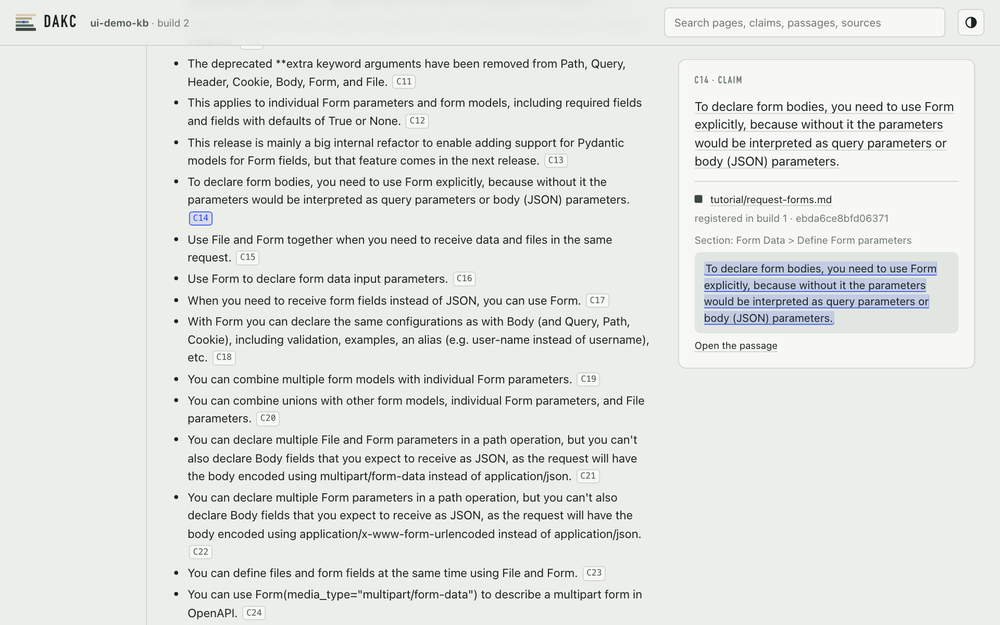

# DAKC: Dependency-Aware Knowledge Compiler

**Knowledge bases shouldn't need to be rebuilt every time a document changes.**
DAKC brings incremental compilation, dependency tracking and full-rebuild
verification to AI-generated knowledge. It tracks claim-level dependencies,
selectively rebuilds invalidated artifacts, and checks incremental results
against an independent full rebuild.

Given a directory of documents, it builds and maintains an LLM-generated
knowledge base: claims, entity pages, topic summaries and an index. When the
sources change, it **recomputes only what has become invalid** and can prove
that the result equals a full rebuild. The same problem appears wherever
LLM-derived knowledge must track evolving inputs: documentation generated
from codebases, research knowledge bases built from papers, policy and
compliance repositories, and long-lived agent memory.

It does this with a build-system model applied to knowledge:

- Every derived artifact records the exact inputs it was built from.
- Sources are hashed per paragraph.
- Claims are content-addressed.
- Rebuilds stop as soon as a recomputed artifact comes out unchanged
  (*early cutoff*).

```text
source ─▶ passage ─▶ claim ─▶ entity / relationship ─▶ page ─▶ topic summary ─▶ index
 (file)   (paragraph)  (fact)      (who / what)        (wiki)     (overview)
```

Edit one sentence in a 5,000-document corpus (deterministic benchmark) and
DAKC re-extracts one paragraph and regenerates only the pages whose claims
changed. Pages whose
claims are unchanged but whose citations moved are re-rendered without an LLM
call. Everything else keeps its exact bytes. `dakc compile --dry-run` tells
you all of this before anything is spent.

**On real docs:** across the last 50 commits to FastAPI's documentation, DAKC
made 259 LLM calls where re-processing each changed file made 267,896, and
its result equalled a full rebuild at every commit. Most of that gap comes
from a large release-notes file edited in almost every commit; see
[examples/fastapi-docs](examples/fastapi-docs/README.md) for the breakdown,
the token counts and the limitations.

> **Status:** research prototype / MVP, CLI-first, local-first. Python 3.12+,
> SQLite, no GPU, no network required (deterministic providers are the
> default). See [what is not done](#limitations).

## Why this exists

The research phase audited twelve open-source LLM-wiki and graph-RAG projects
at the code level ([competitive analysis](research/COMPETITIVE_ANALYSIS.md),
[gap report](research/TECHNICAL_GAP.md)). In those twelve, we did not find
one that does all of the following. That is a statement about what we
audited, not proof that no such system exists.

- tracks dependencies below the file level, or between derived artifacts
  (page → summary → index);
- stops propagation when a recomputed artifact is unchanged;
- tests incremental output against a full rebuild;
- keeps claim identity stable when an LLM rewords unchanged text.

The usual pattern is "a file changed, re-ingest it, and let the LLM merge the
result into existing pages". That pattern is costly, and it keeps facts the
source no longer states (for example llm_wiki issue #837; see the analysis for
code citations). The techniques DAKC uses are not new: verifying traces and
early cutoff come from build systems (Shake, Bazel, Salsa), support counting
from incremental view maintenance, and content addressing from Git. The
contribution is applying them correctly at claim granularity, with a test
oracle.

## Quick start

```bash
pip install dakc                 # Python 3.12+; add [mcp] for the MCP server, [api] for the REST API
dakc ingest ./my-documents       # discover, hash, extract, compile -> ./wiki
```

To run the examples, tests and benchmarks, work from a clone:

```bash
git clone https://github.com/thejasrao262003/dependency-aware-knowledge-compilation.git
cd dependency-aware-knowledge-compilation
uv sync --locked --extra dev && source .venv/bin/activate   # or: pip install -e '.[dev]'

mkdir demo && cp -r examples/sample-knowledge-base demo/knowledge && cd demo
dakc ingest ./knowledge
```

`ingest` creates `dakc.toml`, the store in `.dakc/dakc.db`, and Markdown
output in `wiki/` (`pages/`, `summaries/`, `index.md`). Your source files are
never modified.

## Walkthrough: the Definition of Done

```bash
dakc graph                                   # artifact and edge counts by layer
dakc graph --source databases/postgresql.md  # everything downstream of one source

# edit one claim in a source document...
perl -pi -e 's/supports JSONB/stores JSONB in a binary format/' knowledge/databases/postgresql.md

dakc check                       # new / modified / deleted / renamed / unchanged (content hashes)
dakc explain page:jsonb          # STALE, with the reason and the upstream sources
dakc compile --dry-run           # exactly which artifacts will be affected; writes nothing
dakc compile                     # incremental; only the plan above is executed
dakc diff 1                      # what changed between build 1 and HEAD
dakc verify --against-full       # invariants + identical to a from-scratch rebuild?
dakc rollback                    # restore the previous build (store + wiki files)
```

The dry run in this walkthrough prints the following (real output, unedited):

```text
Compilation Plan
----------------
Strategy: dakc

New Sources:        0
Modified Sources:   1
Deleted Sources:    0
Renamed Sources:    0
Unchanged Sources:  6

Passages to (re-)extract:   1   (extraction cache hits: 0)
Affected Claims:            5   (new 1, retracted 1, changed 0, provenance-only 3, reproduced unchanged 0)
Affected Entities:          2
Affected Knowledge Pages:   2   (regenerate 2, re-render citations only 0, delete 0, checked & unchanged 3)
Unaffected Knowledge Pages: 20
Summaries:                  regenerate 0, delete 0, checked & unchanged 1
Index:                      unchanged

Planned Operations:
- Re-extract 1 passage(s)
- Reconcile 2 entities
- Regenerate 2 page(s), re-render 0
- Update 0 summaries

Estimated LLM Calls: 0 (exact)

No files modified.
```

This is the PRD's example. The edited paragraph also states "PostgreSQL
supports Transactions" and "PostgreSQL supports Indexing". Re-extraction
reproduces those claims with the same ids, so the Transactions, Indexing and
Ledger pages are *checked and unchanged*. Only the JSONB and PostgreSQL pages
are regenerated.

With the default heuristic provider, LLM calls are 0 and the plan is exact.
With an LLM provider, the plan counts the calls it *would* make, does not
make them, and labels downstream numbers as an **upper bound**.

## Commands

| Command | What it does |
|---|---|
| `dakc init [--source DIR] [--provider P]` | Create `dakc.toml` |
| `dakc ingest DIR` | Register a corpus and compile it |
| `dakc check [DIR]` | Classify sources by content hash, including renames and duplicates |
| `dakc compile [--incremental \| --full] [--dry-run] [--json]` | Compile; `--full` is the correctness baseline |
| `dakc compile --strategy file` | The file-level baseline used in the benchmark |
| `dakc graph [--source X] [--format text\|json\|dot\|reactflow]` | Inspect or export the dependency graph |
| `dakc explain ID` | Dependencies, dependents, upstream sources, signatures, history, VALID/STALE |
| `dakc trace PAGE` | Each displayed sentence → cited claims → passage → source version → exact evidence sentence |
| `dakc duplicates` | Advisory list of claims that are likely the same fact in other words (nothing is merged) |
| `dakc status` | HEAD, counts, and what is stale against the current sources |
| `dakc builds` / `dakc diff A [B]` | Audit log; artifact-level diff between builds |
| `dakc rollback [--to N]` | Restore an earlier committed build (later builds' artifact versions are discarded; their records stay in `builds`) |
| `dakc verify [--against-full]` | Invariant and provenance checks, citation coverage, equality with a full rebuild |
| `dakc serve` | Local web UI and read-only REST API (`/status /check /plan /graph /artifacts /artifacts/{id}[/content\|/trace\|/downstream] /builds /diff /duplicates`) |
| `dakc mcp [--read-only]` | MCP server for AI agents ([below](#mcp-server-for-ai-agents)) |
| `dakc watch` | Recompile incrementally on file changes |

IDs can be given in friendly form: `page:database-architecture`,
`entity_postgresql`, `source:databases/redis.md`, a source path, or a page
title. Commands that write (`ingest`, `compile`, `rollback`) take the
workspace build lock; pass `--wait SECONDS` to queue behind a running build
instead of failing. Most commands accept `--json`.

## Python API

Everything the CLI does is available as a library; the CLI, the REST API and
the MCP server are thin layers over it.

```python
import dakc

with dakc.open("demo") as kb:                 # a directory holding dakc.toml
    plan = kb.plan()                          # what a compile would do; nothing written or spent
    if plan.has_work():
        report = kb.compile()                 # incremental; atomic; wiki files updated
        print(report.status, report.llm_calls())

    page = kb.read("PostgreSQL")              # rendered Markdown, version, metadata
    for s in kb.trace("page:postgresql").sentences:
        print(s.sentence, "->", s.cites)      # each sentence and the claims it cites

    kb.explain("page:jsonb").status           # VALID / STALE, with reasons
    kb.downstream("databases/postgresql.md")  # what an edit to this file would invalidate
```

Module functions: `dakc.open(path)`, `dakc.init(path, source_dir=...)`,
`dakc.ingest(directory, workspace)`. `KnowledgeBase` methods: `status`,
`check`, `plan`, `compile`, `artifacts`, `read`, `explain`, `trace`,
`downstream`, `graph_stats`, `export_graph`, `builds`, `diff`, `duplicates`,
`verify`, `rollback`. Every result is a dataclass with `to_dict()`.

Errors derive from `dakc.DakcError`: `WorkspaceNotFound`, `ArtifactNotFound`,
`InvalidArgument`, `BuildLocked`, `CompileFailed` (with `.preserved`: HEAD
still points at the previous build), `CostNotAllowed` and `RollbackError`.
`compile` and `rollback` hold the workspace build lock. Read methods never take
it and see a consistent snapshot while a build runs. A `KnowledgeBase` holds
one SQLite connection, so use one per thread. Details are in
[docs/python-api.md](docs/python-api.md).

## MCP server for AI agents

`dakc mcp` exposes a workspace to agents over the Model Context Protocol.
It needs the `mcp` extra: `pip install 'dakc[mcp]'`.

```bash
claude mcp add dakc -- dakc mcp --workspace /absolute/path/to/demo   # Claude Code
claude mcp add dakc -- uvx --from 'dakc[mcp]' dakc mcp --workspace /absolute/path/to/demo   # nothing preinstalled
```

Other clients take the usual JSON configuration:

```json
{ "mcpServers": { "dakc": { "command": "dakc", "args": ["mcp", "--workspace", "/absolute/path/to/demo"] } } }
```

| Tools | Kind |
|---|---|
| `status`, `check_sources`, `list_artifacts`, `read_artifact`, `explain`, `trace`, `downstream`, `graph_stats`, `builds`, `diff_builds`, `duplicates`, `verify` | read-only |
| `compile` | previews by default; builds only with `apply=true` |
| `rollback` | needs an explicit build id; marked destructive |

Safety rules:

- **One workspace.** The server is bound to the workspace it was started with.
- **Preview first.** `compile` previews unless called with `apply=true`.
- **Cost guard.** With an LLM provider, a build planned to exceed
  `--max-llm-calls` (default 100) is refused.
- **Read-only mode.** `--read-only` removes `compile` and `rollback`.
- **Bounded outputs.** Every list is capped by a `limit` argument, and totals
  are always reported.

The server needs a workspace built first (`dakc ingest DIR`). The default
transport is stdio. `--transport streamable-http` serves HTTP on
`127.0.0.1:8766`. There is no authentication yet, so both HTTP servers
refuse to listen beyond this machine. [docs/mcp.md](docs/mcp.md) covers
setup, the tools, the safety rules and the known limitations.

## Web UI

`dakc serve` opens a local, read-only UI for a workspace. It needs the `api`
extra: `pip install 'dakc[api]'`.


- **Overview.** The knowledge base shown as layers, from the source documents
  at the bottom to the index at the top, with what the next compile would
  change (or what the last one changed).
- **Changes.** The exact plan for pending edits, before anything runs: which
  documents changed, how many LLM calls the compile needs, and which pages and
  summaries it would regenerate.
- **Explore and read.** Search pages, claims, passages and sources. On a page,
  select a citation to see its claim, the source document and version, and the
  exact sentence it came from.
- **Dependencies, impact and graph.** What an artifact is built from,
  everything an edit to it would invalidate, and the dependency graph around
  it.
- **History.** Every build, and what it changed.



The UI is plain HTML, CSS and JavaScript that ships inside the package. There
is no build step and no CDN, and it works offline. Like the REST API, it only
listens on this machine. To see it on FastAPI's docs, run
`python examples/fastapi-docs/ui_demo.py`, then
`dakc serve -w examples/fastapi-docs/.work/ui-demo-kb`.

## Integrations

**MkDocs.** Add one line to an existing `mkdocs.yml`:

```yaml
plugins:
  - search
  - dakc            # pip install 'dakc[mkdocs]'
```

- Every `mkdocs build`, and every live reload of `mkdocs serve`, compiles
  the docs incrementally.
- The knowledge base is published under `/knowledge/`, and every cited fact
  links back to the docs page it came from.
- In CI, cache the workspace directory and every build is incremental.

See [docs/integrations/mkdocs.md](docs/integrations/mkdocs.md) and the
runnable [examples/mkdocs-site](examples/mkdocs-site/mkdocs.yml).

**Real documentation history.**
[examples/fastapi-docs](examples/fastapi-docs/README.md) replays the last 50
commits that changed FastAPI's documentation. At every commit it measures
what keeping a knowledge base current costs under each strategy, and checks
that DAKC's result equals a full rebuild.

## Guarantees, and how each is checked

| Concern | What DAKC does | Checked by |
|---|---|---|
| Incremental = full | Signatures, early cutoff, support counting | `dakc verify --against-full`; regression suite (every scenario, random edit sequences); benchmark oracle |
| Concurrent builds | A workspace build lock covers the whole build; the commit also refuses if HEAD moved since the state was loaded. Readers are never blocked (SQLite WAL) | `tests/integration/test_concurrency.py` (interleaving, two real processes) |
| Model / prompt drift | Extractor, page-writer and summarizer fingerprints (model, prompt, schema) are recorded per artifact; anything built by a different provider is rebuilt | `tests/integration/test_model_drift.py` |
| DAKC's own logic changing | Versioned layers (`dakc.versions`: parser, claim identity, entity resolution, rendering) are recorded with every build; a change re-runs exactly that layer, and rendering changes need no provider calls | `tests/integration/test_model_drift.py` |
| Provenance | Every claim records the exact evidence sentences in each supporting passage. `dakc trace` follows displayed sentence → claim → passage → source version. `provenance = "strict"` renders only sentences that cite a claim | `tests/integration/test_provenance.py`; `dakc verify` reports citation coverage |
| Contradictions | Conflicting claims are both kept, each with its own sources; deleting a source retracts exactly the claims it alone supported | `tests/integration/test_contradictions.py`; benchmark scenario S9 |
| Claim identity | Exact after normalization (never merged by similarity); paraphrases are only *reported* | `benchmarks/equivalence.py` (precision/recall incl. hard negatives) |
| Failures and crashes | All-or-nothing commit; the extraction cache survives for retries; rollback to any earlier committed build | failure-injection and process-kill tests |

## How it decides what to rebuild

Each artifact stores a **signature**: the hash of exactly the inputs it read,
plus the fingerprint (algorithm/model/prompt) of the provider that built it.
An artifact is rebuilt if and only if its signature changes. The full model,
including deletion semantics and dry-run precision, is in
[docs/dependency-model.md](docs/dependency-model.md).

| Change | What DAKC does |
|---|---|
| One sentence edited | Only that sentence is sent to the extractor, with its paragraph as context. Claims of unchanged sentences are reused verbatim, so their pages are untouched even when an LLM would have reworded them. A sentence whose pronoun refers to the edited one is re-extracted too. |
| Sentence deleted or paragraphs reordered | Zero extraction calls; claims of the deleted sentence are retracted. |
| Source deleted | Remove its passages from claims' support sets. Retract claims left unsupported. Pages whose claims survive elsewhere are only re-rendered (citations). |
| Source renamed | Same source id, **zero** LLM calls; citations re-rendered. |
| Duplicate document added | Extraction-cache hit, **zero** extraction calls. |
| Entity aliases changed (`[aliases]` in `dakc.toml`) | Entity resolution re-runs deterministically; only pages whose membership changed are rebuilt. |
| Prompt or model changed | The provider fingerprint changes. Writer and summarizer changes invalidate exactly the pages and summaries they built. An extractor change re-extracts every passage, because each passage records which extractor produced its claims. Pages are regenerated only where the re-extracted claims differ. |
| Build fails (provider error, crash, injected fault) | Nothing is committed. HEAD and the wiki are unchanged; paid extraction results are cached for the retry. |

## Providers

| `provider =` | Use | LLM calls |
|---|---|---|
| `heuristic` (default) | Deterministic sentence-level extraction and template writers; no network | 0 |
| `mock` | Same outputs, but every call is *accounted* as an LLM call with estimated tokens (benchmarking) | simulated |
| `openai` | Any OpenAI-compatible endpoint: OpenAI, **Ollama**, vLLM, LM Studio (`[provider.openai] base_url, model`) | real |
| `anthropic` | Claude via the official SDK (`pip install 'dakc[anthropic]'`, default model `claude-opus-5-5`) | real |
| `custom` | Bring your own client: `[provider.custom] factory = "module:callable"`, which returns an object with `.fingerprint` and `.complete(system, user, json_schema=None)` | real |

The heuristic extractor is a baseline: it treats capitalized and camel-case
terms as entities and each such sentence as a claim. Use an LLM provider for
extraction quality. The invalidation guarantees do not depend on the
extractor.

## Benchmark

Two kinds of numbers appear here, and they are never mixed:

- **Deterministic benchmark (mock provider).** Large seeded synthetic
  corpora. LLM calls are counted exactly but no model is called, and tokens
  are estimated from text length. These results reproduce exactly, and CI
  checks that they do. They measure how much work each strategy schedules on
  this synthetic workload. They do not predict the savings on your corpus.
- **Real-model measurements.** One hosted model on small corpora, with
  provider-reported tokens. They are indicative, not exactly reproducible.

<!-- BENCHMARK:START (generated by python -m benchmarks.report) -->
### Deterministic benchmark (mock provider)

Seeded synthetic corpus, **5,000 documents** (48,933 claims, 2,501 pages, 279,406 dependency edges). Deterministic mock provider: LLM calls are counted exactly, tokens are estimated. All three strategies run in the same engine. *File-level* emulates the strategy of existing LLM-wiki tools.

| Scenario | LLM calls: full / file-level / DAKC | Pages regenerated: full / file-level / DAKC | Stale artifacts (DAKC) | Equal to full rebuild (DAKC) |
|---|---|---|---|---|
| S0 no change | 33,118 / 0 / **0** | 2,501 / 0 / **0** | 0 | yes |
| S1 one source modified | 33,118 / 60 / **11** | 2,501 / 43 / **5** | 0 | yes |
| S2 five sources modified | 33,118 / 146 / **32** | 2,501 / 90 / **15** | 0 | yes |
| S3 one source deleted | 33,111 / 43 / **24** | 2,501 / 22 / **11** | 0 | yes |
| S4 one source renamed | 33,118 / 80 / **0** | 2,501 / 39 / **0** | 0 | yes |
| S5 one claim modified | 33,118 / 50 / **3** | 2,501 / 39 / **1** | 0 | yes |
| S6 new source → popular entity | 33,121 / 13 / **7** | 2,501 / 5 / **2** | 0 | yes |
| S7 contradicting source | 33,119 / 3 / **3** | 2,501 / 1 / **1** | 0 | yes |
| S8 edit touching 7 entities | 33,118 / 73 / **22** | 2,501 / 50 / **11** | 0 | yes |
| S9 contradiction, then original deleted | 33,117 / 13 / **8** | 2,501 / 6 / **4** | 0 | yes |

Across all sizes (100, 1,000, 5,000 documents) and scenarios, every strategy's result was identical to an independent full rebuild, and DAKC never regenerated an artifact whose inputs were unchanged. The smallest LLM-call savings versus file-level at 5,000 documents: S7 contradicting source: 0% (a brand-new fact must be extracted and written under any strategy); S9 contradiction, then original deleted: 38%. Full tables, method and caveats are in [docs/benchmark.md](docs/benchmark.md). Raw data: [benchmarks/results/latest.json](benchmarks/results/latest.json).

**At 20,000 documents** (realistic length and topic distributions; 329,123 claims, 10,002 pages, 1,906,814 dependency edges), LLM calls full / file-level / DAKC: S0 no change 177,546 / 0 / **0**; S1 one source modified 177,546 / 45 / **5**; S3 one source deleted 177,522 / 78 / **39**; S4 one source renamed 177,546 / 44 / **0**; S5 one claim modified 177,546 / 42 / **2**; S9 contradiction, then original deleted 177,546 / 14 / **11**. Every strategy was identical to a full rebuild with 0 stale artifacts. Raw data: [benchmarks/results/scale-realistic.json](benchmarks/results/scale-realistic.json).

### Real-model measurements

`hosted-agent:gpt-4o-mini:t0.0`, 30 synthetic documents (full build: 232 calls, 176,260 input tokens). Calls and tokens are provider-reported; hosted models are not deterministic, so these are indicative:

| Scenario | LLM calls: file-level / DAKC | Input tokens: file-level / DAKC | Pages regenerated: file-level / DAKC |
|---|---|---|---|
| S0 no change | 0 / **0** | 0 / **0** | 0 / **0** |
| S1 one source modified | 27 / **6** | 23,329 / **8,165** | 18 / **3** |
| S3 one source deleted | 19 / **16** | 17,003 / **15,119** | 17 / **14** |
| S4 one source renamed | 25 / **0** | 22,191 / **0** | 16 / **0** |
| S5 one claim modified | 25 / **4** | 22,162 / **6,456** | 16 / **1** |
| S8 edit touching 7 entities | 30 / **15** | 25,157 / **14,300** | 21 / **12** |

Unchanged facts kept with identical claim ids after a one-sentence edit, whole-paragraph re-extraction → sentence reuse: technical: 50.6% → **77.6%** (stale 0 → 0); prose: 51.8% → **87.6%** (stale 0 → 0); coreference: 93.4% → **96.7%** (stale 0 → 0). See *Real-LLM experiment* in docs/benchmark.md.
<!-- BENCHMARK:END -->

## Limitations

- **Real-LLM evidence is limited to one model on small corpora** (see
  *Real-LLM experiment* in docs/benchmark.md).
- **Sentence reuse is conservative by design.** A sentence that may refer
  back to an edited one (a pronoun, "the X", "this") is re-extracted, so on
  real prose roughly 10–25% of unchanged facts are still regenerated, and
  possibly reworded. Trusting the model's own dependency reports would avoid
  that, but was measured to leave stale facts in pronoun cases.
- **Claims must name at least one entity or concept** to attach to a page.
  Statements about nothing nameable are dropped.
- **LLM-written pages are not fully grounded by default.** With the measured
  model, about 28% of generated page sentences cited no claim (see
  docs/benchmark.md). `provenance = "strict"` removes them from the rendered
  page, which keeps an audit list.
- **Paraphrases across sources are not merged.** They appear as separate
  claims, which is redundant but never wrong. `dakc duplicates` lists likely
  pairs.
- **Single host, single writer.** The build lock is a local file lock, and
  SQLite is a single-writer store. Concurrent builds on one machine are
  serialized; there is no multi-host or distributed mode, by design.
- **Heuristic extraction is crude** (see above).
- **Contradictions are kept, not resolved.** Both claims appear on the page
  with their own sources.
- **Large, flat folders make expensive topic summaries.**
  - A topic summary's prompt lists every page in its folder.
  - On FastAPI's docs, the root folder's summary covers about 1,660 pages,
    a prompt of about 55,000 tokens, and it is regenerated whenever a page in
    that folder changes.
  - With an LLM provider, this dominates DAKC's incremental token cost
    ([measured](examples/fastapi-docs/results/replay.md)).
  - A much larger folder could exceed a model's context window.
- **No frontend.** `dakc graph --format reactflow` and `GET /graph` provide
  React Flow data for one.

## Reproduce everything

```bash
make install        # locked environment (uv.lock)
make test           # all test suites
make bench          # deterministic benchmark (100 / 1,000 / 5,000 docs) and regenerated docs
make bench-verify   # re-run 100 docs; every non-timing metric must match benchmarks/results/latest.json (CI runs this)
make scale          # 20,000 docs with realistic document-length and topic distributions
make equivalence    # claim-equivalence evaluation (PROVIDER_CONFIG=... adds the LLM judge)
make llm-bench PROVIDER_CONFIG=provider.toml   # real-LLM experiment (costs provider calls)
```

Deterministic results are exactly reproducible. Real-LLM results are not,
because hosted models are not deterministic, and the docs report them as
indicative.

## Project layout

```text
src/dakc/      kb (the Python API) · errors · cli · api (REST) · mcp_server
               hashing · parsing · ingestion · claims · artifacts · graph · invalidation
               compiler (+ projection) · transactions · provenance (explain, trace, compare, verify)
               providers (heuristic, mock, openai-compatible, anthropic, custom) · storage
research/      competitive analysis, technical gap, architecture decisions, per-repo audits
docs/          architecture, dependency model, Python API, MCP, benchmark (design + generated results), implementation log
benchmarks/    seeded corpus generator + scenarios, runner, report generator, equivalence evaluation, results/
tests/         unit · integration (incl. Python API, MCP) · regression (incremental == full) · benchmark properties
examples/      sample-knowledge-base (Markdown, TXT, JSON, HTML)
```

## License

Apache-2.0. See [LICENSE](LICENSE). Contributions welcome; see
[CONTRIBUTING.md](CONTRIBUTING.md).
