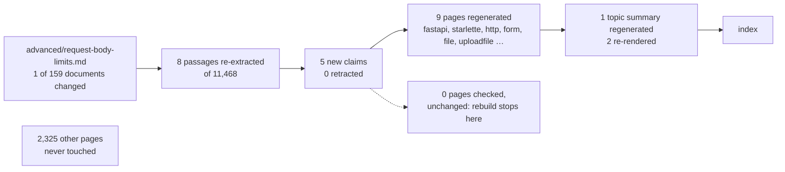

# Walkthrough: DAKC on FastAPI's documentation

_Generated by `examples/fastapi-docs/walkthrough.py` (DAKC 0.4.0). Every output below is real and unedited apart from shortened paths._

FastAPI's English docs (MIT licensed) at [`821d37ee`](https://github.com/fastapi/fastapi/tree/821d37eec1b8ef4cd00d8fac73ecdb54aa94c847/docs/en/docs), then one real commit: [`b0a616d9`](https://github.com/fastapi/fastapi/commit/b0a616d9fa301a50bf5809c64f97e5f2d6ae941d) "✨ Add configurable form parsing limits (#16784)".

## 1. Compile the docs into a knowledge base

159 documents became 11,468 passages, 11,060 claims, 2,334 entity pages, 6 topic summaries and an index, with 63,101 dependency edges. A full build is **14,187 LLM calls**.

## 2. Ask: what happens when a form exceeds FastAPI's parser limits?

**Before the commit.** Facts (claims) mentioning "parser limit":

- *(nothing: the docs do not cover it yet)*

## 3. Apply the real commit

`b0a616d9` changes the docs: 1 file changed, 16 insertions(+).
```console
$ dakc check
Source root: .work/fastapi/docs/en/docs
New sources:       0
Modified sources:  1
  ~ advanced/request-body-limits.md
Deleted sources:   0
Renamed sources:   0
Unchanged sources: 158

Run dakc compile --dry-run to see the affected artifacts.
```

## 4. Preview the rebuild (`--dry-run` writes and spends nothing)

```console
$ dakc compile --dry-run
Compilation Plan
----------------
Strategy: dakc

New Sources:        0
Modified Sources:   1
Deleted Sources:    0
Renamed Sources:    0
Unchanged Sources:  158

Passages to (re-)extract:   8   (extraction cache hits: 0)
Affected Claims:            5   (new 5, retracted 0, changed 0, provenance-only 0, reproduced unchanged 0)
Affected Entities:          9
Affected Knowledge Pages:   9   (regenerate 9, re-render citations only 0, delete 0, checked & unchanged 0)
Unaffected Knowledge Pages: 2327
Summaries:                  regenerate 1, re-render 2, delete 0, checked & unchanged 0   (sections: regenerate 10, reused 101)
Index:                      re-render

Planned Operations:
- Re-extract 8 passage(s)
- Reconcile 9 entities
- Regenerate 9 page(s), re-render 0
- Regenerate 1 summary, re-render 2

Estimated LLM Calls: 25 (exact)

No files modified.
```



**25 LLM calls planned, against 14,187 for a full rebuild.**

## 5. Compile incrementally

```console
$ dakc compile
Compilation Report (build 2, committed)
---------------------------------------
Strategy: dakc

New Sources:        0
Modified Sources:   1
Deleted Sources:    0
Renamed Sources:    0
Unchanged Sources:  158

Passages to (re-)extract:   8   (extraction cache hits: 0)
Affected Claims:            5   (new 5, retracted 0, changed 0, provenance-only 0, reproduced unchanged 0)
Affected Entities:          9
Affected Knowledge Pages:   9   (regenerate 9, re-render citations only 0, delete 0, checked & unchanged 0)
Unaffected Knowledge Pages: 2327
Summaries:                  regenerate 1, re-render 2, delete 0, checked & unchanged 0   (sections: regenerate 10, reused 101)
Index:                      re-render

Operations:
- Re-extract 8 passage(s)
- Reconcile 9 entities
- Regenerate 9 page(s), re-render 0
- Regenerate 1 summary, re-render 2

LLM Calls: 25   Provider calls: 25   Tokens in/out: 13278/7333
Artifact versions written: 47, deleted: 0
Wiki files written: 11, deleted: 0
```

## 6. Ask again, and trace the answer to its source

**After the commit.** Facts (claims) mentioning "parser limit":

- `clm:65774864d5917c16`: Exceeding a parser limit returns HTTP 400.

```console
$ dakc trace clm:65774864d5917c16
Claim: clm:65774864d5917c16
  Exceeding a parser limit returns HTTP 400.
  <- advanced/request-body-limits.md @ 29d94e638c369d3b (registered in build 2), psg:e353927e9e1a0a2d
       "Exceeding a parser limit returns HTTP 400."
```

The same commit also documents `max_files` ("The default is 1,000."). That bullet names no capitalized term, so the free heuristic extractor does not turn it into a claim. It remains findable through full-text passage search (`psg:a4b348e9588d84e8`), which is what agents use through the MCP server. An LLM provider extracts it as a claim.

## 7. Check the result against a from-scratch rebuild

```console
$ dakc verify --against-full
PASS  no dangling edges
PASS  edges point to lower layers (acyclic by construction)
PASS  no dependency cycles (NetworkX)
PASS  stored edges equal edges derived from artifact content
PASS  no valid claim without support
PASS  no entity/relationship without claims
PASS  claim evidence sentences lie inside their passage
PASS  page citation markers point to the page's own claims
PASS  wiki files match the store
INFO  16124 of 18845 generated page sentences cite a claim (85.6%); `dakc trace PAGE` shows which do not
PASS  equal to a full rebuild (content and structure)
```
